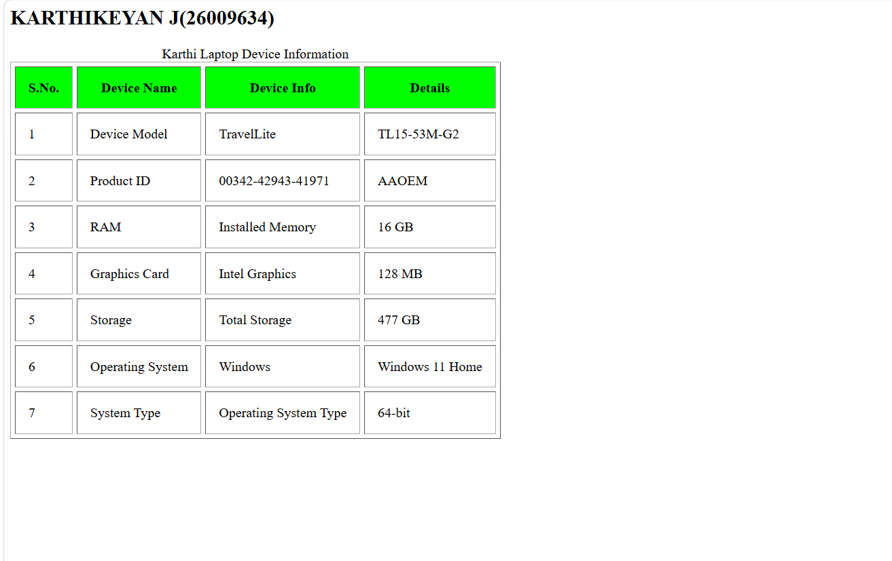
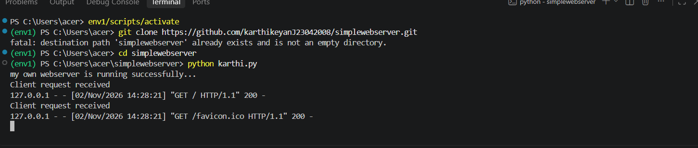

# EX01 Developing a Simple Webserver
## Date:28/09/2026

## AIM:
To develop a simple webserver to serve html pages and display the Windows Specifications of your Laptop.

## DESIGN STEPS:
### Step 1: 
HTML content creation.

### Step 2:
Design of webserver workflow.

### Step 3:
Implementation using Python code.

### Step 4:
Import the necessary modules.

### Step 5:
Define a custom request handler.

### Step 6:
Start an HTTP server on a specific port.

### Step 7:
Run the Python script to serve web pages.

### Step 8:
Serve the HTML pages.

### Step 9:
Start the server script and check for errors.

### Step 10:
Open a browser and navigate to http://127.0.0.1:8000 (or the assigned port).

## PROGRAM:
```
<html>
    <head>
        <title>Device Information</title>
    </head>
    <body>
        <table border="1" cellspacing="5" cellpadding="15">
        <caption>My Laptop Device Information</caption>

            <tr bgcolor="lime">
                <th>S.No.</th>
                <th>Device Name</th>
                <th>Device Info</th>
                <th>Details</th>
            </tr>

            <tr>
                <td>1</td>
                <td>Device Model</td>
                <td>TravelLite</td>
                <td>TL15-53M-G2</td>
            </tr>

            <tr>
                <td>2</td>
                <td>Processor</td>
                <td>Intel Core 5</td>
                <td>2.20 GHz</td>
            </tr>

            <tr>
                <td>3</td>
                <td>RAM</td>
                <td>Installed Memory</td>
                <td>16 GB</td>
            </tr>

            <tr>
                <td>4</td>
                <td>Graphics Card</td>
                <td>Intel Graphics</td>
                <td>128 MB</td>
            </tr>

            <tr>
                <td>5</td>
                <td>Storage</td>
                <td>Total Storage</td>
                <td>477 GB</td>
            </tr>

            <tr>
                <td>6</td>
                <td>Operating System</td>
                <td>Windows</td>
                <td>Windows 11 Home</td>
            </tr>

            <tr>
                <td>7</td>
                <td>System Type</td>
                <td>Operating System Type</td>
                <td>64-bit</td>
            </tr>

        </table>
    </body>
</html>

```

## OUTPUT:

Web page

server page

## RESULT:
The program for implementing simple webserver is executed successfully.
